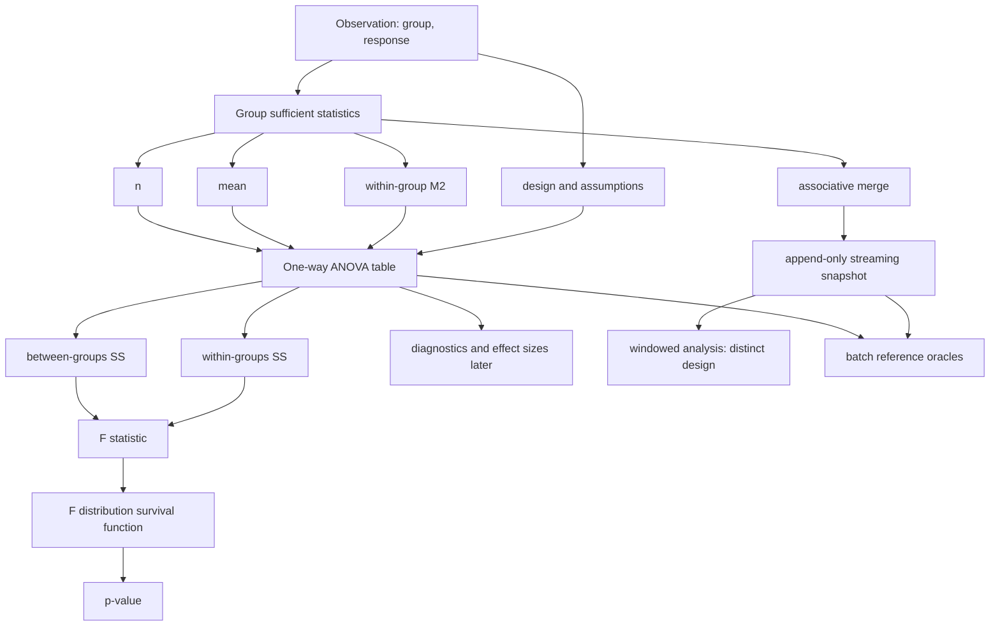

# Concept Graph

**Status:** navigation map  
**Links:** [[Scope and semantic contract]] · [[One-way ANOVA]] · [[Streaming one-way ANOVA]] · [[Numerical stability]] · [[Assumptions and alternatives]]

## Link glossary

| Node | Meaning | Primary page |
|---|---|---|
| Observation | One finite scalar response assigned to exactly one group | [[Scope and semantic contract]] |
| Sufficient statistics | Minimal v1 state per group: count, mean, centered sum of squares | [[Streaming one-way ANOVA]] |
| #$#M_2#$# | Sum of squared deviations from the group mean; not a raw second moment | [[Numerical stability]] |
| ANOVA table | Decomposition of total variability into between- and within-group terms | [[One-way ANOVA]] |
| F distribution | Null reference distribution conditional on classical assumptions | [[One-way ANOVA]] |
| Merge | Combine independent partitions without replaying raw data | [[Streaming one-way ANOVA]] |
| Diagnostics | Evidence about model assumptions; no diagnostic proves them | [[Assumptions and alternatives]] |
| Reference oracle | Independent trusted implementation/data used to validate the Go result | [[Test oracles]] |

## Concept boundaries

1. **Statistics versus inference:** #$#SS_B, SS_W#$# and F are arithmetic outputs; the p-value’s interpretation requires a sampling/design model.
2. **Batch versus stream:** batch input is merely one way to construct sufficient statistics. The same final summary must yield the same result within tolerance.
3. **Append-only versus windowed:** a mergeable state supports partitioned aggregation. It does not by itself prescribe exact removals, event-time ordering, late data, or retention.
4. **One-way ANOVA versus linear models:** one-way ANOVA is a special regression model. The v1 direct formulation avoids prematurely committing to contrast and rank policies.
